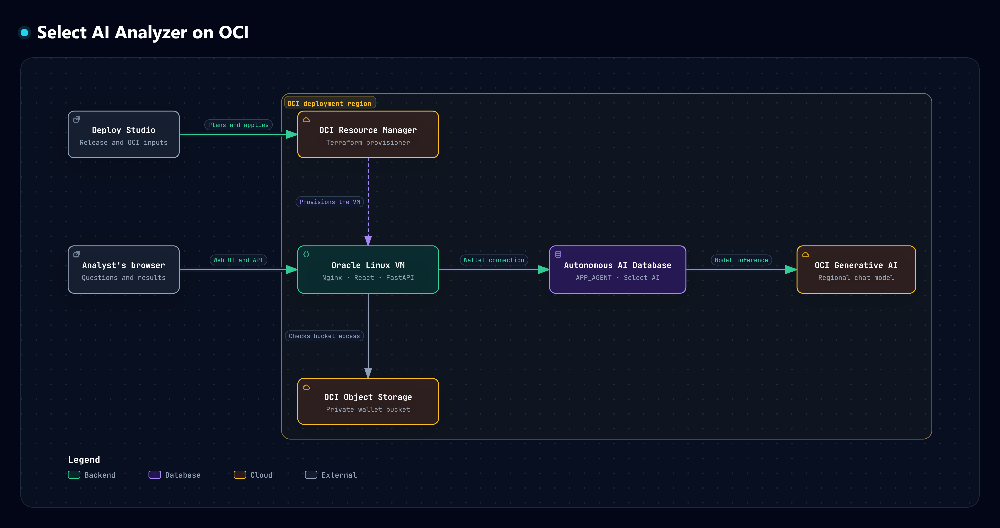

# Architecture

[Editable Archify diagram](assets/architecture-oci.json)

The upper path shows provisioning. The lower path follows a query from the browser through the application to Autonomous AI Database and the configured OCI Generative AI model.

| Component | Responsibility |
| --- | --- |
| [React frontend](../apps/frontend/src/main.tsx) | Provides sign-in, the source catalog, analytics, and dashboards. |
| [Nginx and FastAPI](../docker/nginx.conf) | Serve the web app and proxy /api to Uvicorn inside one Docker container. |
| [Select AI execution](../apps/backend/app/select_ai/select_ai_ask.py) | Builds prompts against registered sources, asks Oracle to generate SQL, validates the SQL as read-only, and executes it. |
| [Autonomous AI Database](../terraform/d_oci_database_autonomous_database.tf) | Stores application metadata, tables, and Select AI profiles. The database calls OCI Generative AI using the configured profile and credential. |
| [OCI Object Storage](../terraform/b_oci_objectstorage_bucket.tf) | Provides the private bucket used by this deployment, including its wallet artifact. |
| [Terraform and OCI Resource Manager](../terraform/README.md) | Provision the VCN, internet gateway, public subnet, security list, compute instance, bucket, and wallet. They create the database only in **Create new** mode. |

## Managed startup

Deploy Studio resolves a release tag to a commit SHA. The VM fetches that SHA and builds the Docker image. After Apply, the Deploy Studio hook verifies the VM's SSH host key against the OCI serial console and transfers the wallet and setup inputs over SFTP. The installer configures the database connection and model inside the container and verifies application login before marking the VM ready. The OCI signing key stays outside the Resource Manager source package and is installed on the VM for runtime OCI calls.

Managed Nginx exposes the setup status endpoint and blocks the remaining setup routes. The standalone Docker installation exposes the wizard on its local loopback port. The OCI lab URL uses HTTP. Use an SSH tunnel for login with test credentials until the deployment is behind a trusted HTTPS endpoint.

## Data and credentials

A new database can load the versioned Sales History or Core Banking demos. Existing-database mode creates an application schema and registers its own metadata. It leaves existing source tables in place and skips demo loading. For a lab, register only the source tables that users should query. Bootstrap grants broad database privileges to the application schema, so use an isolated database for this configuration.

The VM retains the OCI API signing key for OCI and Select AI calls. The Resource Manager package excludes that key. Keep the stack state, wallet, and access attachments private.
